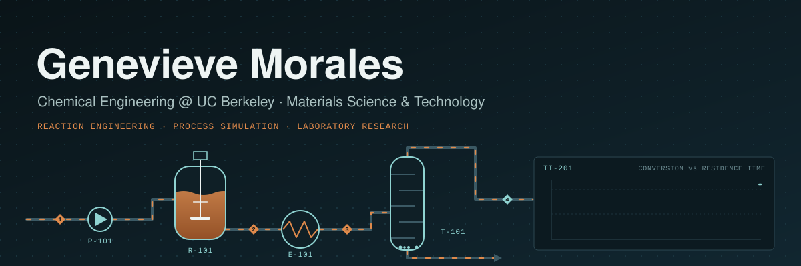
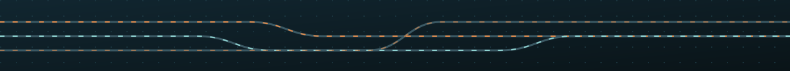

<!--
  Profile README for Genevieve Morales.
  To add a project later, see HOW_TO_ADD_PROJECTS.md.
-->

  

  
  
  

## About

Chemical Engineering student at **UC Berkeley** with a concentration in **Materials Science & Technology** (B.S. expected May 2029). My interests are **reaction engineering, process design, and process simulation**.

I work as a lab assistant in the **Kumar Lab**, supporting animal cell culture research. I use independent projects to apply coursework to real data, models, and hardware, and each finished project is documented here with its code, data, and a technical write-up.

**Currently seeking:** Spring 2027 undergraduate research and Summer 2027 internships in process or chemical engineering.

## Projects

| Project | Description | Tools | Status |
|---|---|---|:---:|
| **[Mycoplasma qPCR Screen](https://github.com/genevievenm13/mycoplasma-qpcr-screen)** | Contamination screen of two cell-culture samples, with a Python melt-curve analysis pipeline | qPCR · Python · pandas · SciPy |  |
| **Biodiesel Reaction Optimization** | Transesterification yield as a function of catalyst loading and methanol-to-oil ratio | Wet lab · yield analysis |  |
| **Acetaminophen Degradation (HPLC)** | Four-week degradation study across storage environments | HPLC · kinetics |  |
| **[Smart Sorting Trash Can](https://smartbin.johnsonto.com/index.html#build)** | 14-person team build of an automated recycling/waste sorter (IR sensor + camera → ResNet50 classifier → servo-tilted platform). My role: cleaning-solution and fragrance formulation, SolidWorks CAD, assembly, system testing, project website | SolidWorks · Raspberry Pi · ResNet50 |  |
| **Reactor Design in Python** | Batch, CSTR, and PFR models for biodiesel transesterification, including a non-isothermal PFR | Python · SciPy |  |
| **Biodiesel Process Flowsheet** | Reactor, methanol recovery, and glycerol separation modeled in Aspen Plus | Aspen Plus |  |
| **Residence-Time Distribution Experiment** | Bench-scale stirred tank with a 3D-printed Arduino colorimeter to measure RTD | SolidWorks · Arduino · Python |  |

## Featured Project: Mycoplasma qPCR Screen

- Screened two cell-culture samples for Mycoplasma by SYBR Green qPCR with amplification, positive, and negative controls.
- Built a Python pipeline that parses the instrument exports, identifies each product by melt temperature, and applies the assay's decision rules.
- Full-curve analysis detected a weak target signal in the positive controls that the instrument's peak calling missed, and identified a contaminated negative control requiring a repeat run.

**[View the repository →](https://github.com/genevievenm13/mycoplasma-qpcr-screen)**

## Skills

**Laboratory** 

**Programming & data analysis** 

**Design & fabrication** 

**Currently learning** 

## Experience

| Dates | Role | Organization |
|---|---|---|
| Jan 2026 – Present | **Chemical & Bioengineering Lab Assistant** | Kumar Lab, UC Berkeley |
| Aug 2026 – Present | **Publicity Chair** | Theta Tau Professional Engineering Fraternity, Epsilon Chapter |
| Feb 2026 – May 2026 | **3D Printing Instructor** | Digital Dreamers STEAM Academy |

## Contact

I'm always happy to talk about research, internships, or projects. 
📧 genevievenm13@berkeley.edu · [LinkedIn](https://www.linkedin.com/in/genevieve-morales-a5aa573a4/)

  

